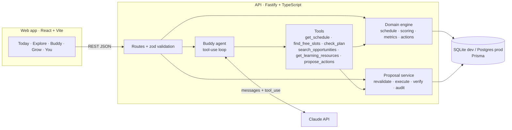
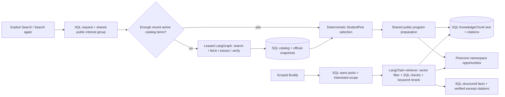

# 04 · Architecture

## Overview


## Decision flow (from the PDD)
Student context → understand request → retrieve reliable context → evaluate relevance, eligibility, capacity → recommend with explanation → request approval when action is needed → execute through an authorized tool → verify → learn from explicit feedback.

## LLM layer (provider-agnostic)
```
Buddy agent · insights · schedule scan · coach
                │  LLM interface: runTools() · json() · text()
        ┌───────┴────────┐
  Anthropic adapter   OpenAI adapter + Ollama wrapper        ← selected by LLM_PROVIDER
  (Messages + tools)  (Chat Completions + function calling)
```
Tool definitions are written once (JSON Schema) and translated by each adapter. Guardrails do not depend on the model: tools validate input, the engine decides facts, and only the approval service writes data.

## LangGraph and LangChain workflows

Opportunity discovery and program-scoped Buddy now use **LangGraph.js** for explicit state transitions and conditional routing. **LangChain.js core/textsplitters** supply Documents, word-preserving text splitting, a scoped BaseRetriever and the prompt-to-LLM runnable chain. The framework work executes in production paths; these are not unused dependencies. The general Buddy/schedule/coach provider adapters still implement the existing provider-neutral LLM interface.

Discovery graph: search → select candidate → fetch official pages → extract → deterministic verification → shared catalog transaction → knowledge ingestion → next candidate. Failed candidates follow a skip branch. Search failures propagate to the existing job failure handler; paid nodes have no graph retry policy. The same RunBudget limits and public-only queries remain authoritative.

Program-question graph: retrieve → draft JSON → verify quotes → finish or refine query → retrieve. It stops after three retrievals/model drafts, repeated normalized queries, or an empty initial result. The program scope is bound by the server's LangChain retriever. Models can suggest a different search phrase, never another program ID or a data-writing operation.

LangChain's CharacterTextSplitter uses word counting and retained separators to preserve the prior 500-word/50-word overlap, normalized text and chunk IDs. PromptTemplate produces a PromptValue, which the bridge converts to text before calling the existing LLM.json adapter. Pinecone, memory and pgvector adapters remain interchangeable; SQL rechecks scope, model identity and snapshot hashes after vector retrieval.

Framework calls run in an explicit tracing-disabled context. No LangSmith account/key is required, and student prompts/passages are not exported to hosted tracing even if ordinary tracing environment flags are present. Local workflow records contain fixed node names, completion/failure status and controlled reason codes, not input/output snapshots. DiscoveryRun.usage and program-message metadata retain those small records.

**Durability boundary:** Prisma still owns leases, usage reservations, job states, conversations and approval records. These graphs do not add checkpoints, replay paid nodes after a crash, or use LangGraph interrupts to approve changes. The existing proposal service remains the sole student-plan write authority after explicit approval. The original framework refactor reused existing tables; the student-scoped rebuild below adds two portable migrations.

Run `npm run demo:workflows` for an offline demonstration with labeled synthetic fixtures and no provider/database calls. `npm run demo:workflows -- --mermaid` prints diagrams generated from the actual compiled graphs. See [workflow walkthrough](13-LANGGRAPH-LANGCHAIN.md) for the code map and demonstration steps.

## Key decisions
| Decision | Choice | Why | Trade-off |
|---|---|---|---|
| LLM vendor | **Claude, OpenAI or local Ollama** via adapters | No lock-in; pick per cost, quality and school requirements | Small differences in tool-calling behaviour; covered by evals |
| Agent topology | **One orchestrating agent** with typed tools | Coherent companion, simpler safety review | Less parallelism than multi-agent |
| Truth source | **Deterministic domain code** for dates, conflicts, eligibility, approvals | Correctness; testable | More code than "let the model do it" |
| Writes | **Proposals only**; execution after approval in a DB transaction with verification | Consent, auditability, idempotency | Extra tap for students |
| Stack | TypeScript end to end (Fastify, Prisma, React/Vite) | One language; Codex-friendly | Not a native mobile app (yet) |
| DB | SQLite for dev, Postgres for prod (same Prisma schema, JSON as strings) | Zero-setup local dev | JSON not queryable in SQL; migrate to `Json` on Postgres later |
| AI calls | Claude Messages API with tool use; JSON-only prompts for briefs/extraction | Structured outputs; images for schedules | Latency 2–20s; UI shows progress |

## Request lifecycle: approval
1. `POST /api/proposals/:id/approve` → status `APPROVED` (audit).
2. Duplicate check by idempotency key → `FAILED` if already applied.
3. `EXECUTING` → **revalidate** the calendar now (it may have changed) → `FAILED` with reason, nothing applied.
4. Prisma `$transaction`: apply all actions, then read back each change (verification). Any error rolls back.
5. `VERIFIED` with result + created ids, or `FAILED` with rollback note. Both audited.
6. Proposals expire after 48h (`EXPIRED`).

## Replit pilot deployment

The current pilot uses one Fastify server to serve the compiled React app and `/api` on `PORT`, binding `0.0.0.0`. Production generates a PostgreSQL Prisma client; Replit applies its schema diff during Publish, SQLite remains the local/Codespaces default. Access codes gate new visitors and are bound to each student at onboarding. Private phrases with single-use recovery codes and hashed HttpOnly cookie sessions restore the same profile on other devices; unlinked legacy profiles can be upgraded in You. Persistent daily student and shared monthly AI quotas are enforced before provider calls. See `DEPLOY-REPLIT.md` for publishing and `docs/06-API.md` for the API contract.

## Longer-term production path *(proposed)*
- **Auth:** Clerk / Auth.js / Supabase Auth; age gate; verified parental consent flows where required.
- **Hosting:** API on Fly.io / Render / Railway; web on Vercel / Netlify; managed Postgres (Neon / Supabase / RDS).
- **Storage:** object storage for attachments (S3/R2) with signed URLs; don't persist schedule photos after extraction unless the student opts in.
- **Jobs:** a queue (BullMQ / Cloud Tasks) for opportunity sourcing, source re-checks and proposal expiry.
- **Observability:** structured logs with PII redaction, error tracking, an eval suite for agent behavior (see backlog).
- **Mobile:** wrap with Capacitor or rebuild in React Native/Expo reusing the API.

## Local AI testing

`LLM_PROVIDER=ollama` reuses the OpenAI-compatible adapter at `OLLAMA_BASE_URL` (default `http://localhost:11434/v1`) with `OLLAMA_MODEL` (default `llama3.2:3b`). No auth header or API key is sent. Local calls allow fifteen minutes with automatic retries disabled; the development proxy and API connection allow twenty minutes in total for a multi-round tool conversation. Invalid tool arguments produce a tool error without execution. JSON-mode rejection or unreadable output gets one plain-text retry with defensive JSON parsing. Student consent and the approval/verification flow apply to every provider. Codespaces provisioning is optional through `USE_OLLAMA` (default on); the service binds to loopback.

## Personal opportunity discovery and RAG



Production sample seeding is off unless DEMO_MODE=true. Active-only rules live in domain/opportunity-active.ts, eligibility in scoring.ts and cost/ranking in picks.ts. SQLite remains the local default, with memory/cosine vectors. Explicit VECTOR_STORE=pinecone uses the official SDK; pgvector is optional. The default store is memory in every environment; set pinecone explicitly for durable production vectors.

OpportunitySearchRequest durably tracks a student search without embedding private data. Group bindings point to public topic/grade-band/region work; an optional cached flag records a queued group that no longer needs paid work. Base/bonus manual slots are reserved, then charged once only after complete/empty settlement. Failed, interrupted, limited or cancelled requests are not charged. Global paid attempt reservations remain counted on failure. Both first search and Search again are explicit and catalog-first. A complete recent active catalog covers each selected interest and the combined three Free/three Paid target without paid work or manual debit, even with AI off or quotas reached. Only absent interests are queued; if all interests are covered but a bucket is short, queue the least-covered topics for that bucket. The worker rechecks gaps before reserving funds, since another student may have filled them. Monthly refresh applies only to students with a completed prior search. Later interest edits expose the explicit bonus action. Current shared usage is read independently of historical limited request status, so raising a cap recovers the control without erasing counters.

Timers, authenticated request-bound work and owner cron share a renewable database lease. Each invocation processes at most one group, one public-program preparation and one source recheck. Request-bound work uses only the signed-in student’s persisted group bindings and current program membership. PostgreSQL serializable write-conflict retries include bounded backoff; these retry database transactions, never paid graph nodes. Autoscale may sleep; use cron for unattended progress.

Store once, link per student: SourcePage and KnowledgeChunk are shared by program. Ingestion skips a matching source hash + embedding provider/model/dimension + vector store/index identity. Switching index therefore re-ingests, even with the same text/model. A per-program lease prevents duplicate simultaneous embedding. SQL remains authoritative after retrieval: reject wrong program IDs, obsolete snapshot hashes, wrong model/store identity and non-opportunity scope. Pinecone metadata contains only chunkId, opportunityId, sourceUrl, pageTitle, checkedAt.

Knowledge preparation runs under the shared monthly AI and recheck/preparation allowance. A public generation/month marker prevents a failed or interrupted paid preparation from replaying on every page load. Subsequent source/model/index generations or the next month can be attempted; no provider retry policy is added. Missing keys or a dimension/metric mismatch disables questions with a safe explanation while search can still produce verified catalog results. Catalog persistence survives optional indexing failures.

Retrieval scope is computed from SQL on each request/turn: current eligible active StudentPicks plus non-dismissed Interested applications, excluding explicit feedback. A caller can select one member or my_opportunities, never supply an allowed-ID list. The vector query filters the set (IN for multiple programs), requests top ten, then SQL validation and keyword reranking return five passages. The read-only LangGraph may refine at most twice more. SQL/rules render deadline, cost, eligibility and status; structured assertions are removed from model quotes. Text claims must be exact excerpts in retrieved passages. Cross-program replies are grouped and cited, with an official link when unsupported. General Buddy also renders server-verified knowledge-tool results rather than unchecked model prose.

Expired picks leave scope immediately; Interested progress remains accessible. Monthly reconciliation removes expired chunks only when no saved application, pick, goal or pending proposal references the program, then removes orphan vectors. Public page snapshots remain available for later source checks. Switching to a different index does not delete the old index; retiring it is an owner operation.

Two additional portable migrations add active/application fields + OpportunitySearchRequest, then KnowledgeChunk.vectorStoreKey. Apply to development PostgreSQL and let Replit Publish apply the production diff; never add DDL to npm start. See [deployment guide](../DEPLOY-REPLIT.md).

Foreground work handles a search group or a standalone program preparation per call, keeping slow providers within the web request window. Timer/cron work shares a three-minute run deadline, checked before funding another stage; a final in-flight provider call can finish after that deadline. Paid nodes are never automatically replayed.

OpenAI extraction passes a provider-neutral JSONSchema option through LLM.json to strict structured output in the adapter. Its evidence object has fixed nullable properties; local Zod parsing removes null evidence and the deterministic verifier still requires literal official-page support. The bounded response allowance is 4096 text tokens plus nano's existing reasoning headroom. Other JSON callers and local/Anthropic behavior remain compatible. DiscoveryRun.usage.models captures requested model identities; typed, redacted output errors preserve the failing stage without provider text. All-operational-failure runs are failed, while evidence-only empty results remain complete/empty. The standalone owner extraction check uses a synthetic fixture and no database/vector services.
