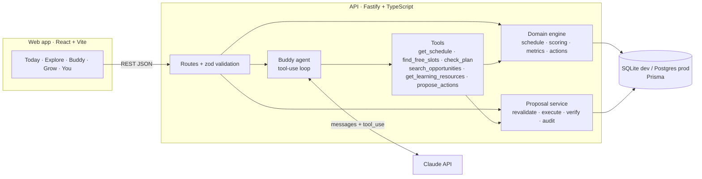

# 04 · Architecture

## Overview


## Decision flow (from the PDD)
Student context → understand request → retrieve reliable context → evaluate relevance, eligibility, capacity → recommend with explanation → request approval when action is needed → execute through an authorized tool → verify → learn from explicit feedback.

## LLM layer (provider-agnostic)
```
Buddy agent · insights · schedule scan · coach
                │  LLM interface: runTools() · json() · text()
        ┌───────┴────────┐
  Anthropic adapter   OpenAI adapter + Ollama wrapper        ← selected by LLM_PROVIDER
  (Messages + tools)  (Chat Completions + function calling)
```
Tool definitions are written once (JSON Schema) and translated by each adapter. Guardrails do not depend on the model: tools validate input, the engine decides facts, and only the approval service writes data.

## Agent frameworks: LangGraph, LangChain and others
**Decision for the MVP: no framework.** The agent is one orchestrator with six tools and a strict approval gate. A thin, typed loop (about 50 lines per provider) is easier to test, audit and explain to schools than a framework abstraction, and it has no extra dependencies to secure.

| Option | What it would add | When to adopt |
| --- | --- | --- |
| **LangGraph.js** | Stateful graphs, checkpoints, durable human-in-the-loop interrupts, parallel branches | When Discover & guide becomes truly multi-agent, or approvals must pause and resume across sessions (Phase 2) |
| **LangChain.js** | Many model and data integrations, retrievers, document loaders | When the sourcing pipeline needs loaders and retrieval over many documents |
| **Vercel AI SDK** | Unified TypeScript API over many providers, streaming UI helpers | If we add more providers or want streaming quickly |
| **OpenAI Agents SDK / Claude Agent SDK** | Vendor-native agent loops and tooling | Only if we commit to one vendor |

**Migration path:** the six tools, the `LLM` interface and the approval service map directly onto LangGraph nodes (orchestrator → tool nodes → an `interrupt` before execute → verify). See prompt 13 in `docs/12-CODEX-PLAYBOOK.md`.

## Key decisions
| Decision | Choice | Why | Trade-off |
|---|---|---|---|
| LLM vendor | **Claude, OpenAI or local Ollama** via adapters | No lock-in; pick per cost, quality and school requirements | Small differences in tool-calling behaviour; covered by evals |
| Agent topology | **One orchestrating agent** with typed tools | Coherent companion, simpler safety review | Less parallelism than multi-agent |
| Truth source | **Deterministic domain code** for dates, conflicts, eligibility, approvals | Correctness; testable | More code than "let the model do it" |
| Writes | **Proposals only**; execution after approval in a DB transaction with verification | Consent, auditability, idempotency | Extra tap for students |
| Stack | TypeScript end to end (Fastify, Prisma, React/Vite) | One language; Codex-friendly | Not a native mobile app (yet) |
| DB | SQLite for dev, Postgres for prod (same Prisma schema, JSON as strings) | Zero-setup local dev | JSON not queryable in SQL; migrate to `Json` on Postgres later |
| AI calls | Claude Messages API with tool use; JSON-only prompts for briefs/extraction | Structured outputs; images for schedules | Latency 2–20s; UI shows progress |

## Request lifecycle: approval
1. `POST /api/proposals/:id/approve` → status `APPROVED` (audit).
2. Duplicate check by idempotency key → `FAILED` if already applied.
3. `EXECUTING` → **revalidate** the calendar now (it may have changed) → `FAILED` with reason, nothing applied.
4. Prisma `$transaction`: apply all actions, then read back each change (verification). Any error rolls back.
5. `VERIFIED` with result + created ids, or `FAILED` with rollback note. Both audited.
6. Proposals expire after 48h (`EXPIRED`).

## Replit pilot deployment

The current pilot uses one Fastify server to serve the compiled React app and `/api` on `PORT`, binding `0.0.0.0`. Production generates a PostgreSQL Prisma client and runs versioned migrations at startup; SQLite remains the local/Codespaces default. Access codes gate new visitors and are bound to each student at onboarding. Username/password accounts and hashed HttpOnly cookie sessions restore the same profile on other devices; unlinked legacy profiles can be upgraded in You. Persistent daily student and shared monthly AI quotas are enforced before provider calls. See `DEPLOY-REPLIT.md` for publishing and `docs/06-API.md` for the API contract.

## Longer-term production path *(proposed)*
- **Auth:** Clerk / Auth.js / Supabase Auth; age gate; verified parental consent flows where required.
- **Hosting:** API on Fly.io / Render / Railway; web on Vercel / Netlify; managed Postgres (Neon / Supabase / RDS).
- **Storage:** object storage for attachments (S3/R2) with signed URLs; don't persist schedule photos after extraction unless the student opts in.
- **Jobs:** a queue (BullMQ / Cloud Tasks) for opportunity sourcing, source re-checks and proposal expiry.
- **Observability:** structured logs with PII redaction, error tracking, an eval suite for agent behavior (see backlog).
- **Mobile:** wrap with Capacitor or rebuild in React Native/Expo reusing the API.

## Local AI testing

`LLM_PROVIDER=ollama` reuses the OpenAI-compatible adapter at `OLLAMA_BASE_URL` (default `http://localhost:11434/v1`) with `OLLAMA_MODEL` (default `llama3.2:3b`). No auth header or API key is sent. Local calls allow fifteen minutes with automatic retries disabled; the development proxy and API connection allow twenty minutes in total for a multi-round tool conversation. Invalid tool arguments produce a tool error without execution. JSON-mode rejection or unreadable output gets one plain-text retry with defensive JSON parsing. Student consent and the approval/verification flow apply to every provider. Codespaces provisioning is optional through `USE_OLLAMA` (default on); the service binds to loopback.
