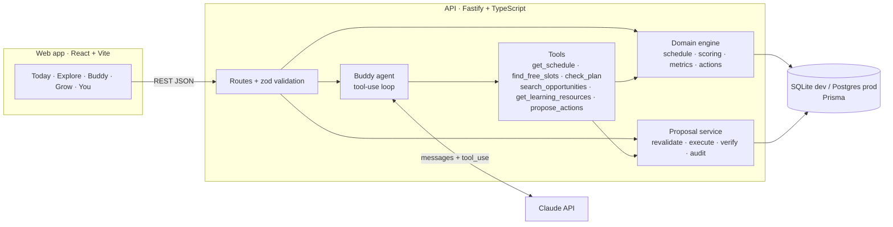
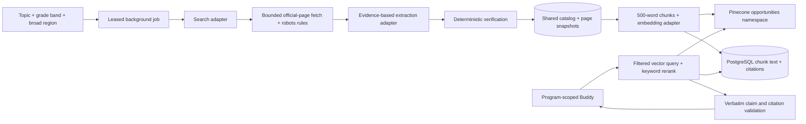

# 04 · Architecture

## Overview


## Decision flow (from the PDD)
Student context → understand request → retrieve reliable context → evaluate relevance, eligibility, capacity → recommend with explanation → request approval when action is needed → execute through an authorized tool → verify → learn from explicit feedback.

## LLM layer (provider-agnostic)
```
Buddy agent · insights · schedule scan · coach
                │  LLM interface: runTools() · json() · text()
        ┌───────┴────────┐
  Anthropic adapter   OpenAI adapter + Ollama wrapper        ← selected by LLM_PROVIDER
  (Messages + tools)  (Chat Completions + function calling)
```
Tool definitions are written once (JSON Schema) and translated by each adapter. Guardrails do not depend on the model: tools validate input, the engine decides facts, and only the approval service writes data.

## LangGraph and LangChain workflows

Opportunity discovery and program-scoped Buddy now use **LangGraph.js** for explicit state transitions and conditional routing. **LangChain.js core/textsplitters** supply Documents, word-preserving text splitting, a scoped BaseRetriever and the prompt-to-LLM runnable chain. The framework work executes in production paths; these are not unused dependencies. The general Buddy/schedule/coach provider adapters still implement the existing provider-neutral LLM interface.

Discovery graph: search → select candidate → fetch official pages → extract → deterministic verification → shared catalog transaction → knowledge ingestion → next candidate. Failed candidates follow a skip branch. Search failures propagate to the existing job failure handler; paid nodes have no graph retry policy. The same RunBudget limits and public-only queries remain authoritative.

Program-question graph: retrieve → draft JSON → verify quotes → finish or refine query → retrieve. It stops after three retrievals/model drafts, repeated normalized queries, or an empty initial result. The program scope is bound by the server's LangChain retriever. Models can suggest a different search phrase, never another program ID or a data-writing operation.

LangChain's CharacterTextSplitter uses word counting and retained separators to preserve the prior 500-word/50-word overlap, normalized text and chunk IDs. PromptTemplate produces a PromptValue, which the bridge converts to text before calling the existing LLM.json adapter. Pinecone, memory and pgvector adapters remain interchangeable; SQL rechecks scope, model identity and snapshot hashes after vector retrieval.

Framework calls run in an explicit tracing-disabled context. No LangSmith account/key is required, and student prompts/passages are not exported to hosted tracing even if ordinary tracing environment flags are present. Local workflow records contain fixed node names, completion/failure status and controlled reason codes, not input/output snapshots. DiscoveryRun.usage and program-message metadata retain those small records.

**Durability boundary:** Prisma still owns leases, usage reservations, job states, conversations and approval records. These graphs do not add checkpoints, replay paid nodes after a crash, or use LangGraph interrupts to approve changes. The existing proposal service remains the sole student-plan write authority after explicit approval. This refactor requires no new database migration, Pinecone index, model setting or service secret.

Run `npm run demo:workflows` for an offline demonstration with labeled synthetic fixtures and no provider/database calls. `npm run demo:workflows -- --mermaid` prints diagrams generated from the actual compiled graphs. See [workflow walkthrough](13-LANGGRAPH-LANGCHAIN.md) for the code map and demonstration steps.

## Key decisions
| Decision | Choice | Why | Trade-off |
|---|---|---|---|
| LLM vendor | **Claude, OpenAI or local Ollama** via adapters | No lock-in; pick per cost, quality and school requirements | Small differences in tool-calling behaviour; covered by evals |
| Agent topology | **One orchestrating agent** with typed tools | Coherent companion, simpler safety review | Less parallelism than multi-agent |
| Truth source | **Deterministic domain code** for dates, conflicts, eligibility, approvals | Correctness; testable | More code than "let the model do it" |
| Writes | **Proposals only**; execution after approval in a DB transaction with verification | Consent, auditability, idempotency | Extra tap for students |
| Stack | TypeScript end to end (Fastify, Prisma, React/Vite) | One language; Codex-friendly | Not a native mobile app (yet) |
| DB | SQLite for dev, Postgres for prod (same Prisma schema, JSON as strings) | Zero-setup local dev | JSON not queryable in SQL; migrate to `Json` on Postgres later |
| AI calls | Claude Messages API with tool use; JSON-only prompts for briefs/extraction | Structured outputs; images for schedules | Latency 2–20s; UI shows progress |

## Request lifecycle: approval
1. `POST /api/proposals/:id/approve` → status `APPROVED` (audit).
2. Duplicate check by idempotency key → `FAILED` if already applied.
3. `EXECUTING` → **revalidate** the calendar now (it may have changed) → `FAILED` with reason, nothing applied.
4. Prisma `$transaction`: apply all actions, then read back each change (verification). Any error rolls back.
5. `VERIFIED` with result + created ids, or `FAILED` with rollback note. Both audited.
6. Proposals expire after 48h (`EXPIRED`).

## Replit pilot deployment

The current pilot uses one Fastify server to serve the compiled React app and `/api` on `PORT`, binding `0.0.0.0`. Production generates a PostgreSQL Prisma client; Replit applies its schema diff during Publish, SQLite remains the local/Codespaces default. Access codes gate new visitors and are bound to each student at onboarding. Private phrases with single-use recovery codes and hashed HttpOnly cookie sessions restore the same profile on other devices; unlinked legacy profiles can be upgraded in You. Persistent daily student and shared monthly AI quotas are enforced before provider calls. See `DEPLOY-REPLIT.md` for publishing and `docs/06-API.md` for the API contract.

## Longer-term production path *(proposed)*
- **Auth:** Clerk / Auth.js / Supabase Auth; age gate; verified parental consent flows where required.
- **Hosting:** API on Fly.io / Render / Railway; web on Vercel / Netlify; managed Postgres (Neon / Supabase / RDS).
- **Storage:** object storage for attachments (S3/R2) with signed URLs; don't persist schedule photos after extraction unless the student opts in.
- **Jobs:** a queue (BullMQ / Cloud Tasks) for opportunity sourcing, source re-checks and proposal expiry.
- **Observability:** structured logs with PII redaction, error tracking, an eval suite for agent behavior (see backlog).
- **Mobile:** wrap with Capacitor or rebuild in React Native/Expo reusing the API.

## Local AI testing

`LLM_PROVIDER=ollama` reuses the OpenAI-compatible adapter at `OLLAMA_BASE_URL` (default `http://localhost:11434/v1`) with `OLLAMA_MODEL` (default `llama3.2:3b`). No auth header or API key is sent. Local calls allow fifteen minutes with automatic retries disabled; the development proxy and API connection allow twenty minutes in total for a multi-round tool conversation. Invalid tool arguments produce a tool error without execution. JSON-mode rejection or unreadable output gets one plain-text retry with defensive JSON parsing. Student consent and the approval/verification flow apply to every provider. Codespaces provisioning is optional through `USE_OLLAMA` (default on); the service binds to loopback.

## Personal opportunity discovery and RAG

Explore now has Interested (the existing application tracker) followed by Free and Paid picks. `domain/picks.ts` balances eligible catalog items without AI. Unknown costs belong to Paid with an explicit warning; only a separately checked official free-cost fact earns Free. A missing suitable item leaves an honest empty slot. Catalog refills preserve the remaining picks and cost no AI calls.



The vector-store interface isolates Pinecone, optional pgvector, and the SQLite/local memory adapter. Pinecone is the recommended production store (and the production fallback when VECTOR_STORE is omitted); `.env.example` explicitly selects memory as the safe local default. Ordinary PostgreSQL migrations require no vector extension. The optional pgvector SQL creates a separate dimensioned vector table with an HNSW cosine index. In every mode, citation text comes from the app database, never vector metadata. Memory vectors are also serialized in KnowledgeChunk.localEmbedding to restore the index after restart; Pinecone/pgvector modes leave that field empty.

Ingestion embeds bounded batches, writes a new vector generation, swaps the authoritative chunk rows transactionally, then deletes old vectors. This is recoverable cross-service work, not a distributed transaction. A monthly reconciliation removes vectors with no database chunk. The server checks index dimension and cosine metric before enabling questions; a mismatch or missing optional configuration disables discovery/questions while catalog features work. Provider outages are retried for readiness after a minute; no discovery/extraction SDK retry can silently multiply the bounded paid calls.

Program questions use a read-only LangGraph workflow: initial retrieval plus at most two rephrases, at most three JSON model drafts through a LangChain runnable. Vector queries filter opportunityId, and SQL checks opportunityId, scope and the current source snapshot hash again. Changed pages cannot serve old chunks while re-embedding is pending. The final answer accepts only verbatim excerpts mapped to returned chunk IDs (up to 120 quoted words), with links and source-check dates. Unsupported output takes the no-answer path. Eligibility and cost remain code decisions. A checklist button creates an `add_application_requirements` proposal; approval revalidates its evidence hash in the transaction before merging steps, preserving completed work, notes and student dates.

A minute timer and the owner-authenticated `/internal/jobs/run` share a persistent global lease and heartbeat. Each invocation refreshes up to 25 due students, processes one shared discovery group and one due source re-check, within monthly reservations and per-run limits. Interrupted groups keep their 30-day cooldown instead of silently paying again. Autoscale deployments need an external scheduled trigger for unattended discovery; a server timer alone cannot wake a sleeping deployment. See DEPLOY-REPLIT.md.

Shared discovery and source re-check attempts also reserve one request against the existing **AI_MONTHLY_LIMIT** overall counter. They never consume a student's daily allowance. Their separate discovery/re-check run budgets are additional limits; an exhausted overall AI cap blocks new paid background attempts too.
