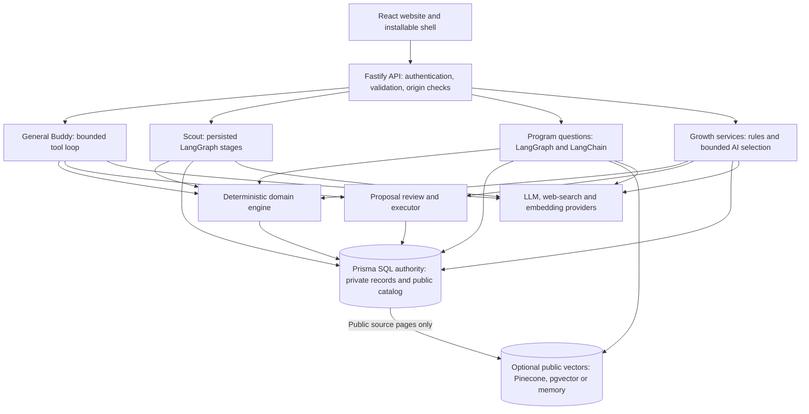
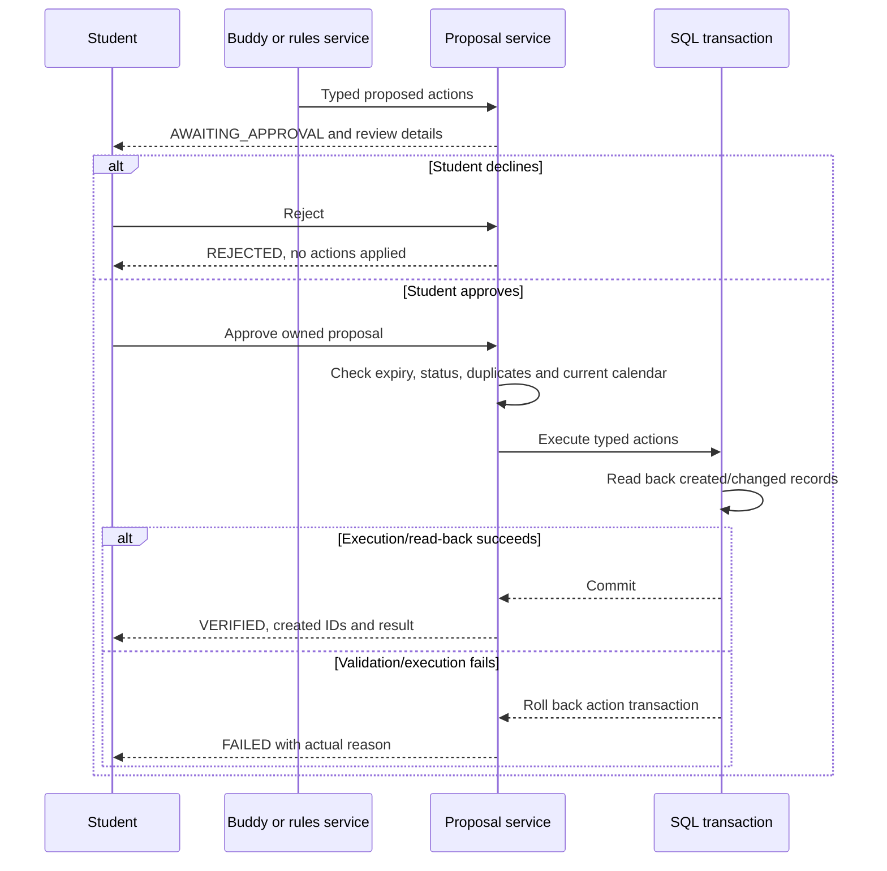
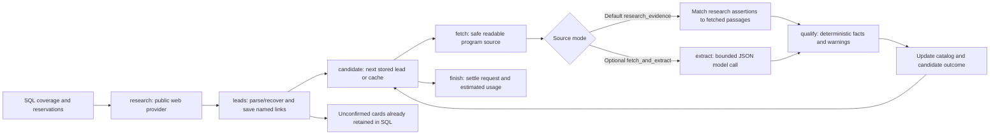
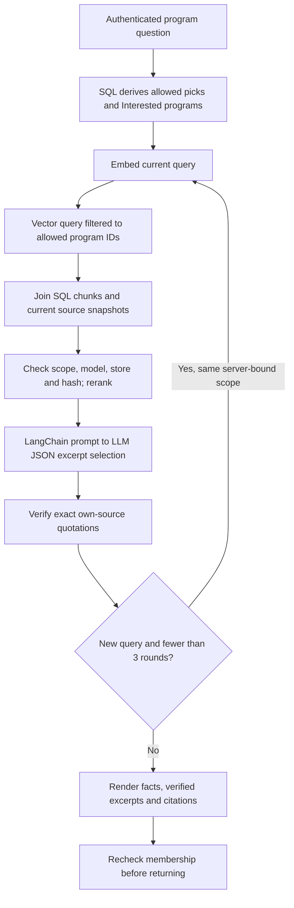

# Pathway AI — end-to-end agentic architecture

**Audited baseline:** `main` at `1878d9e`, including Growth Map Drops 1–3. This describes implemented execution paths. It replaces the earlier diagram that portrayed the app as a Claude-only assistant and the historical Scout pipeline that required every candidate to pass all fields before appearing. Deployment configuration/live availability are not inferred from source code.

Read alongside the [current product specification](PDD.md), [OpenAPI](openapi.yaml), [data model](05-DATA-MODEL.md) and [deployment guide](../DEPLOY-REPLIT.md).

For standalone system, trust-boundary and data-lineage views, see [Architecture diagrams and data flows](19-ARCHITECTURE-DATA-FLOWS.md).

## 1. Architectural model

Pathway is one application with several bounded workflow roles. General Buddy is a model-directed tool orchestrator. Opportunity Scout and program questions use actual LangGraph state graphs. Retrieval uses LangChain components. Planning, approvals, scheduling facts, evidence counting, cache/lease management and most UI behavior are ordinary deterministic services.

It is not a swarm of independently writing agents, and not every model call is a LangGraph agent. The authority boundary is: **models interpret/select/language; code validates facts and permissions; students approve proposed changes; services execute and report observed results.**

The SQL-to-vector arrow represents the indexing service, not database replication. No private student profile, chat, goal, reflection or Growth Map record is indexed in the shared program namespace.

## 2. Runtime and deployment topology

| Layer | Current implementation | Responsibility |
|---|---|---|
| Web | React, TypeScript, Vite, shared CSS tokens | Five tabs, private Growth Map, explicit reviews, voice/browser capabilities |
| API | Node.js/Fastify with Zod, multipart and static serving | Authenticate, authorize, validate requests and call domain/services |
| Domain | `apps/api/src/domain/*` | Date/recurrence math, capacity/conflicts, scoring, source qualification, counts, evidence, history and allowed actions |
| Durable state | Prisma; PostgreSQL production, SQLite local | Account ownership, public catalog, jobs, usage, proposals, sources and private histories |
| Model adapters | `agent/llm/*` and the LLM interface | Provider-specific tool/JSON/text APIs without scattering SDK calls through product code |
| Workflows | LangGraph Scout/question graphs; LangChain retrieval/answer chain | Bounded transitions, retrieval and model-draft validation |
| Optional integrations | Public web sources, embedding/vector providers, read-only iCalendar, publisher feeds, browser push | Independent capabilities with their own configuration/failure states |

Production runs one Fastify website/API on PORT, bound to 0.0.0.0, serving the Vite build and /api under the same origin. Development has a Vite proxy to the API. Replit development and production PostgreSQL databases are separate; SQLite is a local option, not the production store.

`npm run build` generates a PostgreSQL Prisma client, compiles the API and builds the web app. `npm start` checks essential production settings, generates the client and launches the compiled server. It does not run Prisma migrations/DDL. Replit Publish applies reviewed production schema additions. Static build success and `/api/health` are not proof that the database matches every feature.

## 3. Request admission, identity and permissions

1. Access configuration exposes only public feature flags and feedback URL, not allowed invitation values or Secrets.
2. New pilot registration validates the tester code and binds it to the student.
3. A private phrase identifies the account; normalized phrase/recovery values are keyed HMAC hashes under SIGN_IN_SECRET. Production requires a stable secret. Random session tokens are hashed in SQL and delivered as HttpOnly, SameSite cookies with Secure in production.
4. Session authentication takes precedence over the compatibility browser-ID path. Linked accounts cannot be opened just by presenting an x-student-id header. Active invitations, expiration and persistent login throttles are checked.
5. Authenticated handlers derive the student on the server. Model/tool arguments cannot choose another student ID. Source/evidence/application queries add ownership filters.
6. State-changing browser requests with Origin are checked against same-origin/allowed development origins. Zod validates route bodies; service/domain validation handles the operation's additional rules. Not every legacy tool argument has identical boundary coverage, so tool-schema descriptions alone are not a universal security boundary.
7. Existing maintenance admission coordinates normal requests and background work during an authorized owner reset. Owner jobs/diagnostics require a separate JOBS_SECRET Bearer header and are not normal student permissions.

Access codes gate participation; private phrases authenticate profiles; SIGN_IN_SECRET protects account hashes; CALENDAR_SECRET encrypts feed URLs; VAPID keys authenticate push delivery; JOBS_SECRET protects owner work. These values are not interchangeable and do not belong in a student's input fields.

## 4. General Buddy: interpretation, tools and memory

### 4.1 Turn lifecycle

`POST /api/buddy/messages` authenticates the student, checks consent, validates text/conversation/scope and reserves the applicable interactive AI allowance. A supplied program scope routes to the program workflow; otherwise `runBuddy` selects the general path.

General Buddy loads the student's profile/preferences, availability and current goals. It finds/creates an owned conversation, reads up to **12 recent messages**, appends the new user message and persists it. The system prompt includes the user's name and personal context. The configured provider's `runTools` receives the conversation and the fixed server tool registry, with **six tool-loop rounds** allowed.

The model chooses when to request a tool. Code binds the authenticated student ID, executes the tool and returns structured results/errors. The model receives observations and can continue within its bound. Tool events and proposal IDs are recorded for the UI. The final assistant reply and metadata are stored in SQL; an empty reply gets an honest fallback, not a fabricated success.

This is short-window conversational memory backed by stored conversation history, not a vectorized personal-memory system. The model does not automatically read every historical chat or learn a shared cross-student profile.

### 4.2 Tools and authority

| Tool | Reads or produces | Authority limit |
|---|---|---|
| get_schedule | Expanded occurrences, conflicts and per-day capacity for a bounded date range | Read-only calendar inspection; description limits range to 21 days |
| find_free_slots | Candidate slots inside availability, respecting commitments/rest/daily study limit | Finds options; does not book them |
| check_plan | Problems for draft sessions against the current schedule/rules | Validation, not execution |
| search_opportunities | Ranked existing SQL catalog entries and checks | Not a general web-search tool; current expiration policy applies |
| search_knowledge | Current allowed program facts/passages and citations | Scope is derived from owned picks/Interested; bounded searches |
| get_learning_resources | Matching curated resources/URLs | No arbitrary fabricated resource link |
| propose_actions | One reviewable proposal and its status/ID | Cannot approve or execute it; no general database-writing tool |

If `search_knowledge` provides a server-verified reply in the general loop, that reply overrides the model's final free-form wording for that result. General conversational/coaching text outside those constrained outputs is not passed through a universal semantic fact verifier.

## 5. Proposal architecture: approval, execution and verification

Agent-originated mutations go through `createProposal`; direct student forms remain separate explicit authenticated CRUD actions. Rules-first services such as prep planning and Growth Map can also create a proposal without an LLM call.

`ProposalInput` contains a summary, rationale and bounded typed actions. Creation validates the action schema, goal references, source-backed requirement actions and calendar problems. It computes an idempotency key, reuses an equivalent awaiting proposal, and stores actions, explanation, data used, effect, status, log and a **48-hour expiry**.

Supported actions include adding/moving/removing an internal event, adding a goal/step, saving a program, adding a portfolio entry and adding official application requirements. Imported calendar events are read-only; moving recurring events is restricted. Requirement execution revalidates citations/hash and merges supported checklist/deadline information.

Approval loads the owned awaiting proposal, expires stale records, records approval, checks whether equivalent actions were already verified, rechecks calendar rules and executes actions in a Prisma transaction. Verification reads back record existence/removal inside that transaction. Proposal states/audits are persisted around it: APPROVED → EXECUTING → VERIFIED or FAILED; rejection/expiry are terminal alternatives.

**Practical boundary:** this is typed transactional action execution with read-back checks and duplicate prevention, not a formal proof of every semantic postcondition or distributed exactly-once execution. Proposal status/audit updates are not all part of the same transaction as domain actions. The current implementation should not be described as a LangGraph human-interrupt/checkpoint transaction or a fully concurrency-proof generic command bus.

Manual event entry can explicitly override a reported conflict, and reviewed schedule bulk import does not run the same full proposal constraint pipeline. The constraints on AI-proposed plans must not be advertised as a blanket guarantee that no student can ever create an overlapping event.

## 6. Opportunity Scout: durable, catalog-first public research

### 6.1 Enrollment and shared coverage

An explicit Explore action calls `enqueueSearch`. SQL coverage is checked first using real unexpired public links and the student's current interests/choices. If sufficient coverage exists, the request can finish as cached without new research, including when AI is off or caps are reached.

If coverage is missing, consent/configuration/allowances are checked, the request is stored and bound to shared discovery groups keyed by interest/grade-band/region. Existing pending compatible work can be reused. The scheduler coalesces compatible groups while keeping public context sanitized; it does not copy whole private profiles into a shared job.

The current defaults authorize up to two research batches per search intent, up to five web tools per research batch and at most sixteen candidate leads across the job's planning limits. These are configurable bounds, not a promise of sixteen valid programs or ten visible cards. Candidate, page, call, timeout and spending budgets are tracked independently.

### 6.2 Actual LangGraph execution

`scout/runner.ts` builds the current `pathway_resumable_scout` StateGraph. The older `discovery/graph.ts` remains in the repository, but it is not the source of truth for the current default foreground Scout path.

Graph nodes are research, leads, candidate, fetch, extract, qualify and finish. Cheap SQL transitions can be grouped, but one advancement stops before a second network/model stage. A visible Explore screen POSTs bounded advancement requests and polls status; background/owner job invocations can also advance it. Research has a configurable bounded provider timeout (default 150 seconds); the host can still impose a shorter request limit.

### 6.3 Links-first recovery and factual qualification

Research returns named HTTPS URLs with optional details and short supporting quotes. A tolerant parser keeps valid siblings when optional metadata is malformed. If JSON is unreadable, only actual provider-returned citations/literal URLs can recover leads. If none can be recovered, one format-only repair may be used across the whole search intent; it cannot search again or invent facts/URLs.

Valid named links are stored before enrichment. Invalid/unsafe URLs are not admitted as executable source addresses. In default **research_evidence** mode, the worker reads one best-effort program page and checks the research assertions against fetched passages in deterministic code. There is no separate extraction AI call for each candidate. Optional **fetch_and_extract** mode performs bounded source extraction and can inspect limited same-origin supporting pages.

Source fetching applies HTTPS/credential/port checks, public-DNS validation/pinning, robots policy, redirect review, content/size/decompression/time limits and attempt accounting. A .org domain is not proof of official ownership. Content and retrieved instructions are untrusted data.

Qualification keeps only supported structured values. Unconfirmed organizer, grades, fees, location, dates or requirements remain unknown with notes. Reviewed source support is required for Verified status. For current valid-link admission, **only a confirmed past deadline is a hard exclusion**; uncertain eligibility/location/format/current application status/source review produces warnings/ranking factors. Source-fetch or extraction failures do not erase an already saved useful unconfirmed link.

### 6.4 Persistence and crash behavior

| Record | Role |
|---|---|
| OpportunitySearchRequest | Student request, group bindings, status/results and successful-slot accounting |
| DiscoveryGroup / DiscoveryRunGroup | Shared public work grouping and links from one run to groups |
| DiscoveryRun.state | Serialized Scout stage/context/candidate/in-flight marker and research output |
| DiscoveryRun.usage | Models, observed/estimated usage, failures, calls, saved IDs and spend reservation |
| ResearchCandidate | Public URL/name, fetched pages/assertions, outcome/rejection reasons and catalog link |
| Opportunity / SourcePage | Shared program facts and actual fetched public source snapshots |
| JobLease | Cross-instance worker admission and persistent preparation/reconciliation markers |

Before a paid research/extraction stage the runner persists an in-flight marker. After the result it persists output and advances. If a process stops after the provider may have been contacted but before output is recorded, the worker does not silently replay that unknown paid stage. It uses durable saved output when available, otherwise records an interrupted outcome and skips/finishes safely. Terminal usage settlement uses a running-to-terminal compare-and-set to avoid a second final debit.

LangGraph provides transitions, not a separate persistent checkpointer here. PostgreSQL is the durable state/lease/usage authority. SQL writes and external provider calls cannot be made one atomic transaction; the in-flight marker is a deliberate recovery boundary, not an exactly-once vendor guarantee.

### 6.5 Catalog display, background renewal and costs

The UI displays at most five confirmed Free plus five Paid/cost-unconfirmed cards; three/three coverage settings remain backend search/pick targets. SQL retains additional leads for reuse and refill. Picking/Interested membership stays private. Automatic catalog renewal can enqueue due work on the rolling refresh cycle for participating students, and source rechecks/knowledge preparation are separately bounded jobs; not every background operation requires a fresh click.

Failed/empty explicit research can be retried after one hour, with a shared unsuccessful-attempt limit per group/day. Those failures preserve the student's successful-search slot but do not erase incurred global usage. A retry can be explicit and bounded without being an automatic replay of the same uncertain paid stage.

## 7. Program knowledge: ingestion, retrieval and grounded answers

### 7.1 SQL and vectors are different stores

SQL owns program identity, structured facts, raw public source text, check times, membership and chunk metadata. Pinecone/pgvector/memory stores vectors used to find relevant chunks. Pinecone is **not the recommendation catalog** and is not a personal-student database.

A search can populate Opportunity links while SourcePage/KnowledgeChunk/vector counts remain zero, for example when sources cannot be read. This does not prove the web search failed. Only real fetched public text is chunked; the system does not manufacture a source page from a model quotation to fill the index.

### 7.2 Ingestion and readiness

`prepareKnowledgeBatch` works on selected/saved public programs, uses source/model/index/month generation markers and reserves bounded shared work. It can recheck missing/stale source pages or ingest existing snapshots. Repeated visits do not replay a failed generation indefinitely.

LangChain Documents and a word-counting CharacterTextSplitter create approximately **500-word chunks with 50-word overlap**. The embedder is selected independently of the conversational LLM. Implemented options include OpenAI, Pinecone inference, Voyage and Ollama, subject to their configured credentials/model/dimension.

Vector stores include memory for local use, Pinecone and an optional pgvector adapter requiring the correctly provisioned KnowledgeVector table/extension. SQLite forces the local memory path. Local memory vectors can be rehydrated from matching SQL localEmbedding data; they are not a production cross-instance shared-memory substitute.

Pinecone uses the **opportunities namespace**, cosine similarity and an index dimension that must match the embedding model/output. Model identity and vector-store identity are part of chunk generation, alongside source content hash and chunk position. Changing model/dimension/index requires preparing the matching generation, not merely changing a display setting.

The Pinecone adapter inspects schema before paid work. Classic reserved dense vectors use the Vectors API; caller-named dense fields use Documents API vector operations; a single dense `embed` string field uses Documents API text upsert/search. Integrated mode uses the index's frozen model/dimension, skips separate external embedding and includes API/input/field/model in chunk identity. SQL commits follow complete write acknowledgement. Fixed public-topic queries keep raw student questions/history out of Pinecone; the original question is used locally for reranking. Read-only owner diagnostics report the actual API/input/field and ID read-back. See [compatibility/recovery](21-EXPLORE-RECOVERY.md).

Ingestion writes new vectors, commits replacement SQL chunks and retires old vectors. This is not a distributed transaction. Retrieval accepts only SQL-backed matching chunks, and reconciliation removes orphan/retired vectors. Public source/chunk retirement preserves entries still referenced by students where the cleanup rules require it.

Knowledge initialization records controlled unavailable reasons and retries readiness after a short cooldown. Misconfiguration can disable program questions while web search/catalog access continue through their independent gates.

### 7.3 Retrieval and answer verification

`ProgramRetriever` is a LangChain BaseRetriever with program IDs bound by server code. It queries up to ten vector matches, re-fetches allowed SQL chunks, checks scope/embedding/store/source hash, combines similarity and keyword relevance, and returns up to five passages.

Scoped Buddy loads up to **six recent conversation messages** and invokes `createQuestionGraph`. The model selects exact excerpts as `{chunkId, quote}` and may suggest a refined query. Code verifies chunk ownership and literal containment, filters structured-fact quotations, bounds the total returned quote words and limits refinement to **three retrieval/draft rounds** without repeating the same normalized query.

The server supplies structured deadline/cost/eligibility/application facts separately from SQL/rules, groups cross-program answers and includes source URLs/check dates. It recomputes membership before returning. Unsupported questions say the official pages do not say; free-form guesses are not substituted. Program questions require configured/prepared knowledge even when some structured facts are already in SQL.

The program workflow is read-only. Adding requirements/prep/reminders uses a separate explicit proposal endpoint and revalidation at approval.

## 8. Growth Map: deterministic evidence plus bounded AI

### 8.1 Evidence pipeline

A student action exposes a source for review. Rules match a versioned 70-skill catalog; suggestions are unselected. Explicit confirmation validates ownership, dates and supported stages in a serializable write with unique source/skill keys. A review stores a source-state fingerprint; it does not duplicate raw reflections as evidence.

A read recomputes live sources and qualifies evidence. Weekly Study groups and explicit milestone/capture links prevent inflation. Interest-only tags do not imply completion; Applied is not attendance. Hidden skills leave visible evidence/insight scope. Supported stages remain independent, and saved growth-letter reflections are excluded from evidence/capture counts.

### 8.2 Insight generation

```mermaid
flowchart LR
    Sources[Owned live sources and confirmed tags] --> Signals[Code: counts, trends, reflection keyword signals]
    Signals --> Candidates[Permitted insight types, factual wording and own evidence IDs]
    Candidates --> Claim[SQL refresh lease and AI reservation]
    Claim --> Model[Model selects bounded factual options]
    Model --> Validate[Exact wording, citations and action validation]
    Validate --> Fresh[Recheck consent, hidden state and live fingerprints]
    Fresh --> Cache[Private dated cache]
    Cache --> UI[Evidence links, Not me, next steps]
    UI --> Proposal[Explicit goal proposal requiring approval]
```

Insights need three distinct confirmed activity groups. Code qualifies growing activity, reflection themes, genuine co-occurrence and next-stage options; unrelated study blocks do not become connected just because they share a week. Focus and persistent dismissal/type feedback affect candidate priority.

The provider receives only compact visible-skill facts, allowed formulations and opaque evidence references, not names/raw titles/full reflections. It selects up to three different types with wording under 35 words. Arbitrary prose is rejected even when its numbers look plausible. Stored cards are revalidated at read time and after an in-flight response.

A persisted token lease/serializable claim protects weekly automatic and local-day manual slots across tabs/instances. A provider failure or invalid response consumes the accepted attempt; a pre-provider quota refusal restores the unused slot with cooldown. Cached valid cards survive server/provider/cap failures as consent permits. Expired abandoned leases stop spinning; cooldown rechecks allow a raised cap to be retried.

### 8.3 Monthly letters and charts

Domain code computes the previous completed local month, truthful retained-record counts, three-activity threshold, supported grown skills and one next-month idea. AI selects a supplied factual story under 120 words with exact permitted evidence IDs. Quiet/AI-off/error/capped cases have a deterministic summary.

GrowthLetter has one student/month row with cached content/fingerprint, attempt/lease/cooldown state and an optional unique portfolio copy reference. At most one accepted AI attempt is made for that report month. Source/consent changes invalidate cached AI text without silently paying again. Saving a copy is a separate explicit verified transaction; deleting the copy clears its pointer while leaving the archive. A copied summary never becomes new achievement evidence.

The monthly worker runs bounded batches of five while awake under a maintenance-aware lock. On-visit POST preparation catches up on sleeping hosts; owners can schedule the protected job endpoint. Neither timer is a guarantee of midnight execution on Replit Autoscale.

History charts are read-only domain queries over live qualified evidence: six local months, zero-filled, current month marked partial. No AI call or new history table is involved.

## 9. Provider, budget and failure architecture

The common LLM interface is `runTools`, `json`, `text`, with optional usage metadata. Anthropic/OpenAI/Ollama adapters translate tool schemas, conversation turns, JSON/image requests and provider errors. Task factories can choose models for search, extraction, insights and letters independently. Search has its own OpenAI/Anthropic web-tool adapters; embeddings have their own provider/model/dimension contract.

| Task | Principal selection controls | Important boundary |
|---|---|---|
| Buddy/coach/scan/brief | LLM_PROVIDER and OPENAI_MODEL / ANTHROPIC_MODEL / OLLAMA_MODEL | One accepted feature request may contain multiple bounded model rounds |
| Public research | SEARCH_PROVIDER, AI_MODEL_SCOUT / SEARCH_MODEL | Separate web-tool provider; default evidence-first mode |
| Optional extraction/format repair | AI_MODEL_EXTRACTION, selected LLM provider | Not a per-candidate call in default evidence-first Scout |
| Growth insights | AI_MODEL_INSIGHTS | OpenAI task default gpt-4.1-mini; bounded wording selection |
| Monthly letter | AI_MODEL_LETTER, then insight/task default | One accepted attempt per student/report month |
| Embeddings | EMBEDDING_PROVIDER, EMBEDDING_MODEL, EMBEDDING_DIMENSION | Must match index; not selected by OPENAI_MODEL alone |

These are implementation selection rules, not proof of the owner's current production model IDs. A ChatGPT consumer subscription is not the app's API credential/billing configuration.

Interactive requests reserve AIUsage atomically against a per-student UTC daily key and shared UTC monthly key. Shared catalog runs reserve overall AI allowance without using a particular student's daily counter. Discovery additionally reserves run/recheck count and estimated-dollar capacity before funded work. Usage/reservations persist across restarts; a startup never erases testing costs.

The personal rolling successful-search allowance, shared research runs, accepted AI requests, actual provider/web calls, tokens, estimated dollars and real invoices are different units. Discovery settles unused estimated funds only after terminal compare-and-set. Token/tool estimates can differ from actual charges; the application estimate is not a vendor-enforced hard billing cap.

SDK automatic retries are disabled for paid Scout/Growth task calls; there is an explicit bounded format-only repair path and local Ollama compatibility fallback. General Buddy adapters have their own behavior and should not be described as universally retry-free. Unknown paid outcomes are not replayed by the persisted Scout/Growth recovery rules.

## 10. Data boundaries and trust

| Boundary | Data that can cross | Data deliberately excluded |
|---|---|---|
| General personal Buddy → LLM | Request/history, name, profile/preferences, goals and requested schedule/tool observations | Credentials, server Secrets; no claim that all personal context is removed |
| Schedule extraction → LLM | Student-submitted text/images for the review task | No continuous microphone/audio archive |
| Public Scout → research provider | Interests/grade band/date, sanitized broad city/state/region, format/cost groups, excluded public URLs | Identity, private project/goal prose, exact schedule/sign-in data |
| Public source ingestion → embeddings/vector store | Fetched public program passages and public source metadata | Student profile/chats/goals/reflections/application progress |
| Program questions → model | Scoped public passages, question and recent scoped conversation | Other students' records or model-selected scope expansion |
| Growth insights/letters → model | Counts, visible catalog skills, bounded factual formulations, public matches where used, opaque evidence IDs | Name/school/location, raw activity titles, full reflections, hidden/dismissed options |
| Read-only calendars → fetcher | Encrypted-at-rest private feed URL is used to fetch the feed | No external calendar-writing OAuth permission |
| Opted-in push → browser push service | Encrypted subscription use and bounded nudge payload | No unapproved emails/applications or guarantee of delivery |
| Browser voice → browser speech implementation | Browser-managed speech recognition/playback after enablement | No Pathway audio-upload/storage endpoint |

Retrieved pages and user/provider text are untrusted data. Prompt instructions reinforce that boundary; code enforces source/scope/quote/action constraints where implemented. An exact quote is not by itself proof that a source is official; reviewed-source status, content identity and uncertainty labels remain separate.

SQL separates public library data from student-owned membership/activity. Most private dependents cascade on account deletion; export includes Growth Map caches/dismissals/letters. Anonymous shared monthly accounting and public program knowledge can remain after one student is deleted. Portfolio sharing is a visibility field, not implemented cross-account delegation.

Framework calls run inside an explicit tracing-disabled wrapper with empty external callbacks. LangSmith may be a transitive/runtime dependency, but hosted tracing is not needed and student prompts are not intentionally exported there. This does not change the chosen inference provider's own data handling.

## 11. Background work and side-effect boundaries

| Worker/control | Trigger while server is awake | Persistence/limit |
|---|---|---|
| Calendar sync | Minute polling for due links; immediate/explicit sync | Per-link claim and syncAfter; three-hour normal interval |
| Gentle nudges | Minute polling plus explicit test | Opt-in, local quiet/class checks, unique student/date reservation; no uncertain-send replay |
| Opportunity jobs | Minute polling, visible Explore advancement, protected owner invocation | Shared JobLease, persisted stages, request/run/cost limits |
| Program knowledge | Bounded preparation during job/foreground work | Source/model/index/month markers; one public program per batch |
| Vector reconciliation | Monthly persistent marker during jobs | SQL references/known IDs govern retirement/orphan cleanup |
| Growth letters | Hourly bounded worker, visit catch-up, owner endpoint | Five profiles per run; one accepted AI attempt per report month |

Timers stop when the host sleeps. Provider timeouts do not override hosting request timeouts. Push acceptance means a push service accepted the request, not that a device displayed it. Read-only calendars and publisher/source fetches are authorized network reads; they do not authorize registrations, emails or external calendar modifications.

## 12. Diagnostics, releases and test evidence

Student discovery status exposes scoped phase/count/failure summaries. Owner JOBS_SECRET endpoints expose public research diagnostics and safe configuration/readiness information; fixture/configuration modes differ from explicitly funded live tests. Tests use synthetic records and providers; a passing mock does not prove current external connectivity or answer quality.

`npm run check:growth` and `/internal/growth-map/readiness` issue zero-row reads of every scalar column in ten required Growth Map tables. They report core-map/insight/letter readiness separately without loading student records or applying schema changes. This is feature readiness, not automatic migration/promotion.

A reliable release checks development migrations, tests/type/build, a real PostgreSQL upgrade, production Publish additions, production feature readiness and signed-in flows. Core health can be green while a feature table is missing. Conditional Growth failures are contained so a missing letter/insight table does not crash the dashboard.

This documentation update reran **558 tests across 65 files** and API/web type checking successfully. It changes no application code or schema and performs no production migration or live paid provider test. No production Secrets/student data were inspected. Operational availability remains a separate release check.

## 13. Operating limits and extension rules

- No arbitrary model SQL, shell, browser automation or external submission tool is exposed to Buddy.
- No shared vector memory for private students, no parent-role authorization system and no automatic family-message delivery are implemented.
- LangGraph transitions are real, but not every component uses it, and it does not own proposal approvals or a persistent checkpointer in this release.
- General coaching/chat is not subjected to the narrow source-excerpt/template verifier used for program/Growth outputs.
- Direct student CRUD and agent proposals have different validation paths; adding a new write must preserve the appropriate explicit approval/ownership boundary.
- Student-facing Today/Growth month math uses local wall-clock helpers, usage resets use UTC, and shared research uses its public/server date conventions. New date features must make their clock explicit rather than assuming every legacy Date call is already student-local.
- New model providers belong in the adapter layer; new deterministic facts belong in domain code; new shared knowledge must remain public/scoped; new Growth tables need both portable migrations, export/cascade behavior, readiness and deployment notes.
- This release does not establish universal concurrency correctness, legal certification, exact external billing, guaranteed push delivery or always-on scheduling. These are not capabilities to imply in product copy.

## 14. Code map and related contracts

| Concern | Source of truth |
|---|---|
| API admission/deployment | [app](../apps/api/src/app.ts), [startup](../apps/api/src/index.ts), [production launcher](../scripts/start-production.mjs) |
| Identity/access | [accounts](../apps/api/src/lib/accounts.ts), [auth](../apps/api/src/lib/auth.ts), [access](../apps/api/src/lib/access.ts) |
| Buddy model loop/tools | [Buddy](../apps/api/src/agent/buddy.ts), [tools](../apps/api/src/agent/tools.ts), [LLM contract](../apps/api/src/agent/llm/types.ts) |
| Allowed actions/approval | [action schema](../apps/api/src/domain/actions.ts), [proposal service](../apps/api/src/lib/proposals.ts), [requirements](../apps/api/src/knowledge/requirements.ts) |
| Current Scout workflow | [runner](../apps/api/src/scout/runner.ts), [scheduler](../apps/api/src/scout/scheduler.ts), [requests](../apps/api/src/discovery/requests.ts), [qualification](../apps/api/src/domain/scout-qualification.ts) |
| Source safety/recovery/cost | [page fetcher](../apps/api/src/discovery/pages.ts), [research recovery](../apps/api/src/scout/research.ts), [spend ledger](../apps/api/src/discovery/spend.ts) |
| Public knowledge | [preparation](../apps/api/src/knowledge/preparation.ts), [indexing service](../apps/api/src/knowledge/service.ts), [retriever](../apps/api/src/knowledge/retriever.ts), [scope](../apps/api/src/knowledge/scope.ts) |
| Program answer graph | [question graph](../apps/api/src/knowledge/question-graph.ts), [LangChain answer chain](../apps/api/src/knowledge/answer-chain.ts), [answer renderer](../apps/api/src/knowledge/buddy.ts) |
| Workflow privacy | [tracing boundary](../apps/api/src/workflows/privacy.ts) |
| Growth Map | [evidence](../apps/api/src/domain/growth-map.ts), [insights](../apps/api/src/growth-map/insights.ts), [letters](../apps/api/src/growth-map/letters.ts), [history/month rules](../apps/api/src/domain/growth-letters.ts) |
| Quotas/leases | [AI limits](../apps/api/src/lib/ai-limits.ts), [job lock](../apps/api/src/lib/job-lock.ts), [maintenance](../apps/api/src/maintenance/admission.ts) |
| Deployment/feature contracts | [Replit guide](../DEPLOY-REPLIT.md), [current sourcing](08-OPPORTUNITY-AND-NEWS-SOURCING.md), [Growth 1](16-GROWTH-MAP.md), [Growth 2](17-GROWTH-INSIGHTS.md), [Growth 3](18-GROWTH-LETTERS.md), [OpenAPI](openapi.yaml) |
