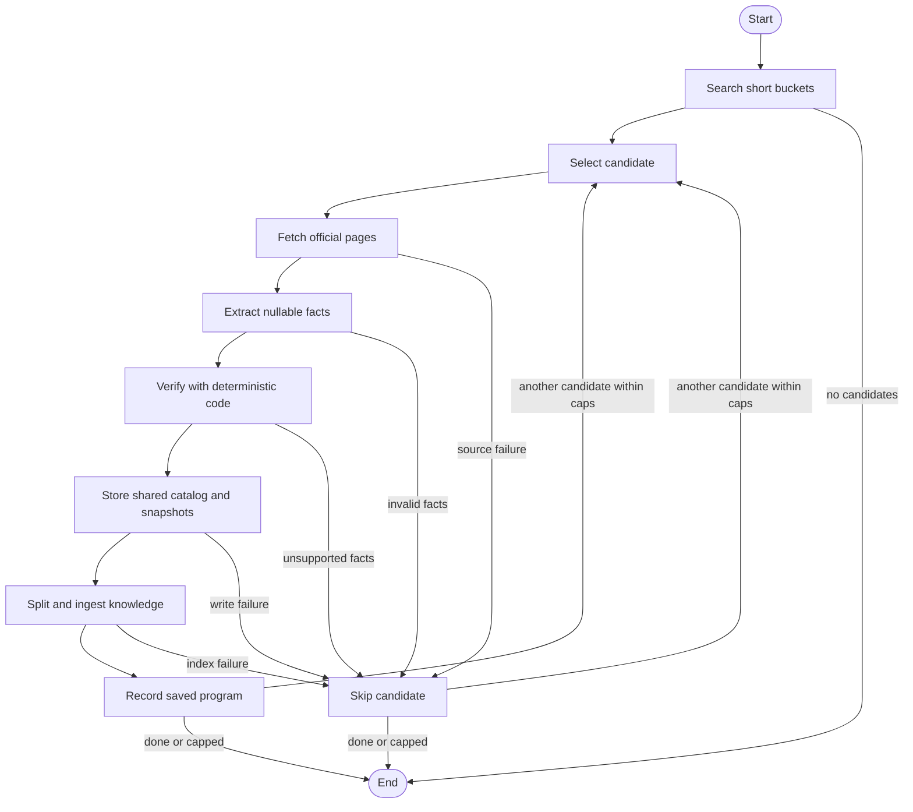
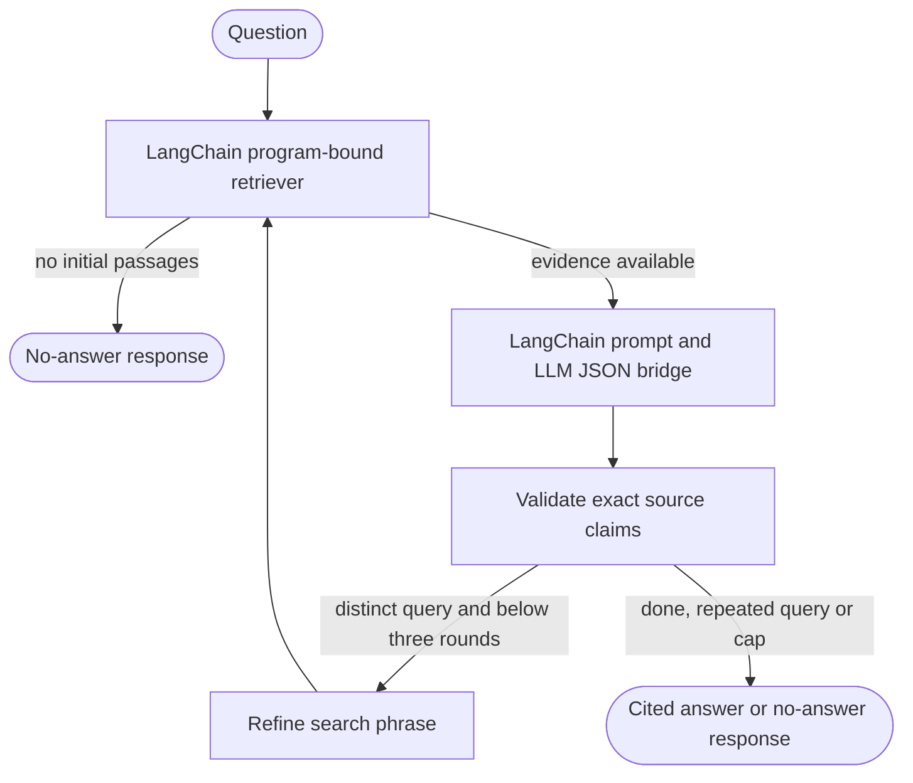

# LangGraph and LangChain in Pathway AI

Pathway now uses LangGraph for opportunity discovery and program-question routing, and LangChain for document preparation, scoped retrieval and prompt/model composition. The purpose is inspectable stages, bounded research and testable evidence handling. Students keep the same Explore, Interested and Buddy experience.

## Run the demonstration

```sh
npm ci --include=dev
npm run demo:workflows
npm run demo:workflows -- --mermaid
```

The demonstration uses labeled synthetic fixtures and a mock model/search provider. It runs the actual compiled LangGraph definitions and LangChain document/prompt components without a database, credentials or paid calls. It does not add the fictional demo program to the app. The output shows discovery stages, one follow-up retrieval, a validated source quote and zero student writes. The second command produces Mermaid diagrams from the compiled graphs themselves.

For a technical demonstration:

1. Show the generated discovery graph and explain why verification comes before catalog storage.
2. Run the offline example and inspect the recorded stage order.
3. Show the question graph's retrieve → draft → verify → refine path. The demo requests a follow-up query before answering from a real fixture excerpt.
4. Run `npm test` to demonstrate budget stops, unsupported-claim rejection, repeated-query stops, scope filtering, concurrent state isolation and the existing approval/rollback behavior.
5. On a configured deployment, open a program in Explore, inspect the citations and source-check dates, then review a checklist proposal before approving it. Deployment steps remain in DEPLOY-REPLIT.md.

## Discovery graph



`discovery/graph.ts` defines typed LangGraph Annotation channels and conditional edges. `discovery/pipeline.ts` supplies existing search, safe fetch, extraction, verification, transactional catalog storage and ingestion services. It invokes the compiled graph under the privacy context. The unchanged job runner still reserves overall/monthly budgets and owns the durable lease/cooldown. Search failures reach the job failure handler; candidate failures skip that candidate. No automatic graph retry policy is installed.

The older pipeline retains its legacy caps for compatibility. Production Scout now uses `scout/runner.ts`: SQL-checkpointed research/leads/candidate/fetch/extract/qualify/finish nodes, one foreground network stage, up to three funded batches and sixteen queued leads per search, one format-only repair and a thirty-day accepted-source cache. `domain/scout-qualification.ts` handles deterministic source evidence; a model cannot update control state or mark facts verified. Shared embedding caps and provider retries are unchanged. See [Scout](14-OPPORTUNITY-SCOUT.md).

## Program-question graph



`knowledge/question-graph.ts` owns the bounded loop. Model output is `{claims:[{chunkId,quote}], nextQuery?:string|null}`. A suggested search phrase can trigger another retrieval, but only the server-bound program is searched. The loop ends after three retrievals/model drafts, a repeated normalized query, or no initial evidence. Exact source matching and the 120-word quote limit run after each draft; unsupported claims cannot become displayed facts.

`knowledge/answer-chain.ts` composes LangChain PromptTemplate with a RunnableLambda bridge to the existing provider-neutral LLM.json interface. PromptValues are converted to strings before entering the adapter. OpenAI, Claude and Ollama retain their existing adapters/model settings and token handling. A program question still counts as one interactive AI feature request, including its internal bounded rounds.

## LangChain components

| Component | Production responsibility |
| --- | --- |
| `Document` | Carries official text with source URL/title/check date/hash. |
| `CharacterTextSplitter` | Uses word counting and retained separators for the existing 500-word chunks and 50-word overlap; no forced re-embedding or changed index dimensions. |
| `RunnableLambda` / `pipe` | Composes official-page preparation and the prompt-to-existing-LLM bridge. |
| `BaseRetriever` (`ProgramRetriever`) | Queries the selected store for ten matches, checks program/scope/model/snapshot hash in SQL, reranks by keyword overlap and returns five cited Documents. |

Dependencies are the modular JavaScript packages `@langchain/langgraph`, `@langchain/core` and `@langchain/textsplitters`. The umbrella `langchain` package is not needed for these components. The LangSmith utility dependency is used only to establish a tracing-disabled execution context; no hosted tracing account is needed.

## Persistence, approval and privacy

Prisma owns durable conversations, job states, leases, quotas, catalog snapshots and approval records. Graph state is local to an invocation. This implementation adds no LangGraph checkpointer or checkpoint tables. If a worker stops, the existing job interruption/cooldown policy prevents automatic replay of paid work. It does not claim crash-resumable graph execution.

Student-plan changes still use the persisted proposal → explicit approval → transactional revalidation → verification → audit flow. Neither graph has authority to add checklist items, calendar events or other student changes directly. Shared public-catalog storage is the existing owner-enabled background operation.

Hosted LangSmith tracing is explicitly disabled around framework calls, including nested retriever and prompt executions. This prevents tracing flags from exporting student questions/history/passages. Local workflow records contain only controlled node names, status and optional failure reason codes. They appear in DiscoveryRun.usage.workflow and scoped ChatMessage.meta.workflow; the student UI continues to display its existing calm status/citation messages.

No new environment variable, service secret, database migration or Pinecone index is required. Keep existing configuration, AI consent, usage limits, scheduled trigger and catalog fallback. Live provider/Pinecone behavior still needs checking with the configured deployment; the offline demo is an architecture demonstration, not a claim that web sources have been checked.

## Verification

`framework-workflows.test.ts` exercises the actual compiled graphs and LangChain components. Existing discovery, retrieval, citation, quota, login, application and approval tests remain in the suite. Re-run `npm test`, `npm run typecheck` and `npm run build` before merging. The generated diagrams and node records let reviewers inspect the architecture directly.
