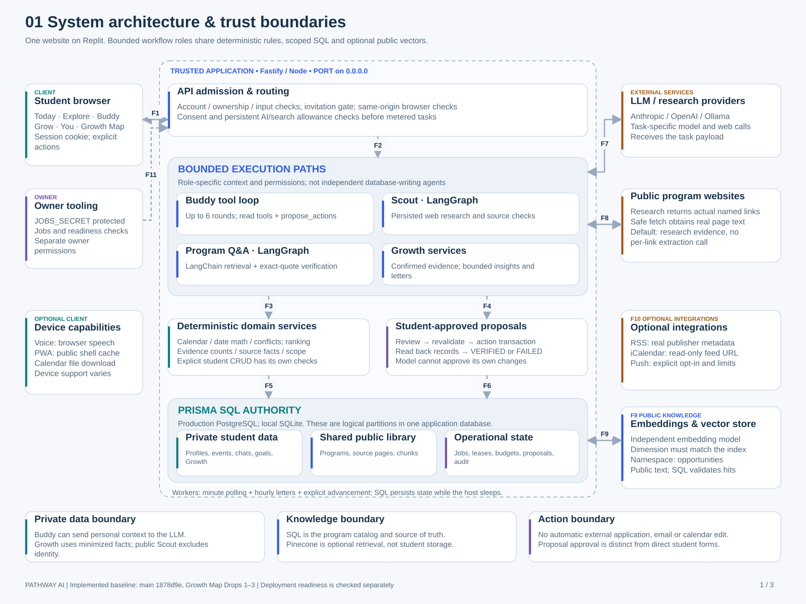
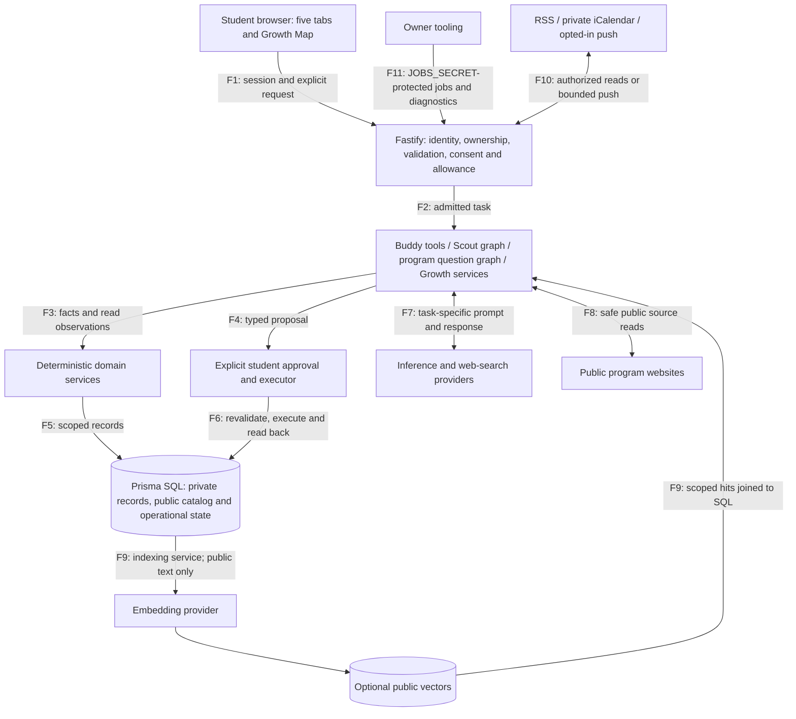
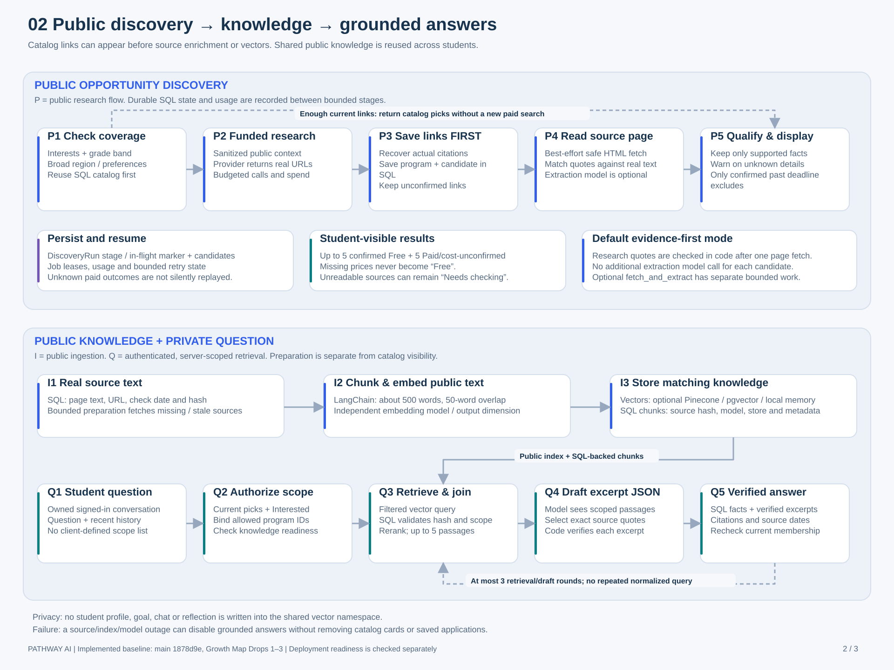
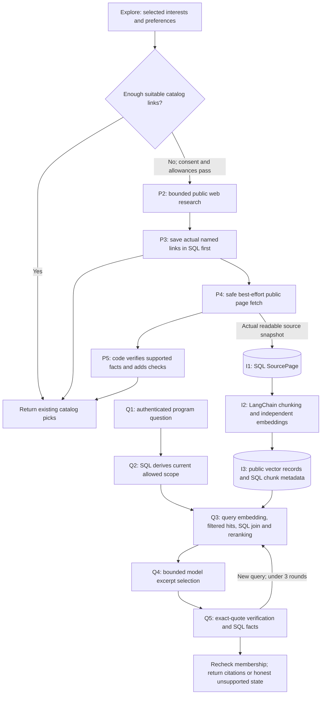
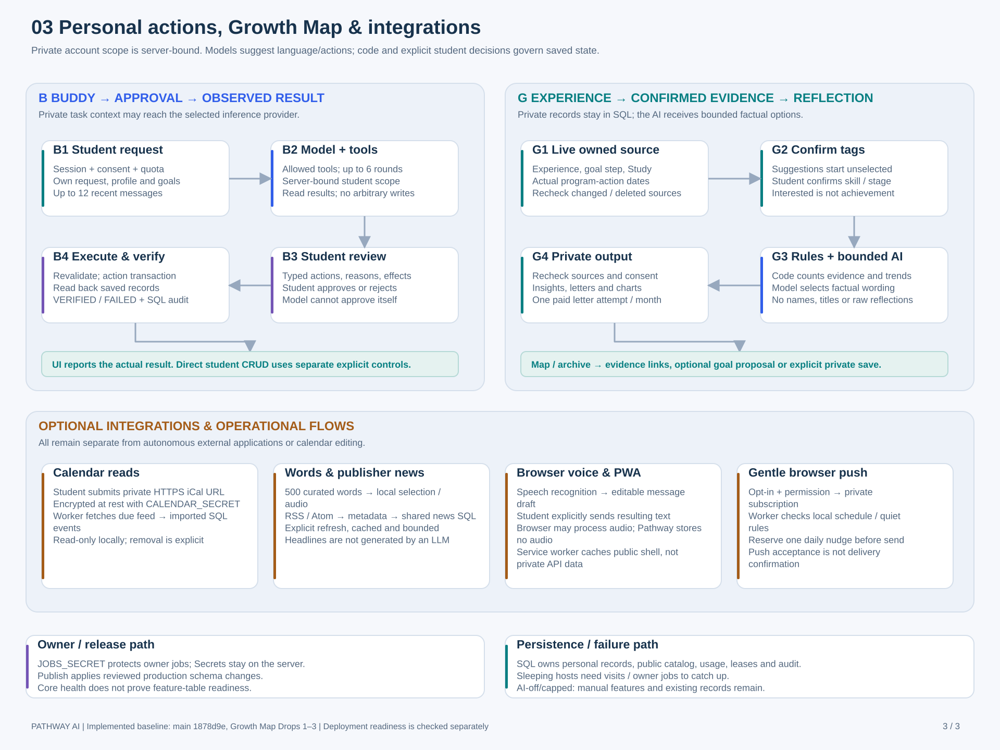
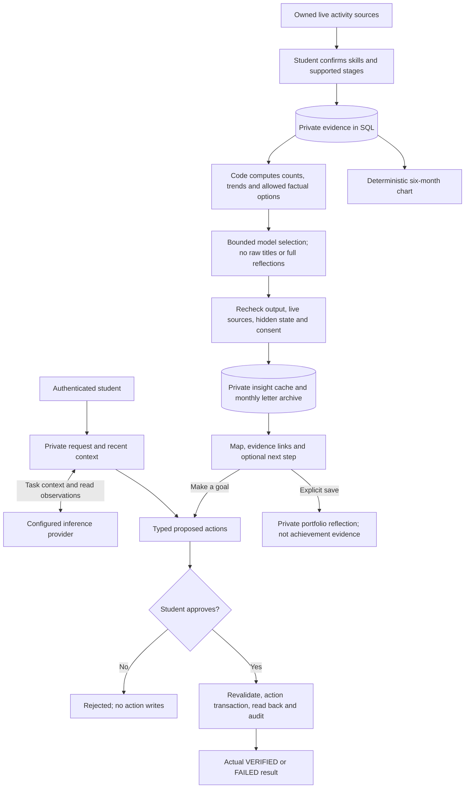

# Pathway AI — architecture diagrams and data flows

These views accompany the [current product specification](PDD.md) and [end-to-end agentic architecture](04-ARCHITECTURE.md). They describe the implemented `main` baseline `1878d9e`, including Growth Map Drops 1–3. They do not attest to live provider configuration or production database readiness. All three drawings are editable, self-contained SVGs; the Mermaid views below offer an alternative editable representation.

## 1. System architecture and trust boundaries

The Replit boundary is a logical application boundary, not a claim that every database or third-party service is physically inside one container. Fastify serves the built React application and API on one origin/PORT. PostgreSQL is the production SQL authority; the three SQL compartments are logical data groups, not separate databases. Local development can use SQLite. Shared jobs run while the host is awake and can also be advanced by visits or protected owner calls.

| Flow | Payload / processing | Authority and persistence |
|---|---|---|
| F1 | Session cookie, form/chat input, explicit student actions; responses restore the owned profile and UI state | Server authentication/ownership, origin/input validation; client never supplies arbitrary cross-student scope |
| F2 | Admitted request routed to Buddy, Scout, program questions or Growth services | Consent and applicable persistent allowances before metered work; deterministic features remain independent of AI |
| F3 | Read observations, dates, conflicts, ranking and evidence/count inputs | Domain code computes facts; model wording is not authoritative arithmetic |
| F4 | Typed proposed changes with explanation and intended effects | Awaiting student review; only the student approves; direct student forms are a separate authenticated path |
| F5 | Account-owned reads/writes and permitted shared public library reads | SQL scoping, validation and feature-specific transactional rules |
| F6 | Approved actions, current-data revalidation, transactional writes and read-back checks | Actual VERIFIED/FAILED result plus proposal/audit records; status/audit updates are not all in the action transaction |
| F7 | Task-specific provider request and model/tool response | Personal Buddy can send name/profile/goals/history; public Scout excludes identity/private prose; Growth sends minimized factual options |
| F8 | Research URLs and supporting assertions; safe public page fetches and actual readable page text | Named links enter SQL first; code verifies source support; fetch failures need not remove useful unconfirmed links |
| F9 | Public chunks → embedding provider → vectors; question embedding → scoped matches → SQL validation | Independently configured model/dimension; Pinecone namespace `opportunities`; no private student memory in the shared index |
| F10 | Optional RSS metadata, private read-only iCalendar feed fetches, opted-in push payloads | Separate authorized network operations; the drawing groups these integrations rather than implying an LLM writes them |
| F11 | Owner diagnostics, readiness reads and job advancement | Separate JOBS_SECRET Bearer authorization; never included in browser code or URL query strings |

The provider arrows summarize request/response exchanges, not a promise that every workflow calls every provider. Optional integrations and browser capabilities are grouped to keep the system drawing readable; their individual data paths are detailed in view 3.

## 2. Opportunity discovery, knowledge ingestion and answers

The discovery lane and knowledge lane are intentionally separate. A stored Opportunity link is a useful catalog result even when no SourcePage or KnowledgeChunk exists yet. Pinecone is a retrieval index, not the catalog and not proof that research ran. The arrows show stage order and data dependencies; they do not imply that every stage executes in one HTTP request or one database transaction.

| Lane | Input → output | Critical rule |
|---|---|---|
| P1–P2: admission and research | Selected interests, grade band and sanitized broad preferences → bounded provider research response | Reuse adequate catalog coverage first; reserve the appropriate usage/spend before paid work |
| P3: links first | Actual returned named URLs/citations → Opportunity and ResearchCandidate rows | Recover real citations when possible; do not fabricate fallback URLs |
| P4–P5: enrichment and display | Real fetched page text and supported assertions → structured facts, warnings and ranked cards | Default `research_evidence` uses deterministic quote checks rather than an extraction call per link; only a confirmed past deadline excludes a valid link |
| I1–I3: public ingestion | Actual source snapshot → LangChain chunks → embeddings, SQL metadata and optional vector records | Approximately 500-word chunks/50-word overlap; model, store, hash and dimension must match the current generation |
| Q1–Q3: authenticated retrieval | Question + owned current program membership → query embedding, vector hits and checked SQL passages | Allowed scope comes from current picks/Interested; recheck SQL identity/hash/model/store and return up to five reranked passages |
| Q4–Q5: bounded answer | Scoped passages/question/recent conversation → excerpt JSON → verified quotations plus SQL facts and citations | At most three nonrepeating retrieval/draft rounds; recheck membership before returning; unsupported answers say so |

The display is up to five confirmed Free and five Paid/cost-unconfirmed cards. Backend coverage targets remain distinct from this display cap. A provider/source/index failure does not imply deletion of stored catalog cards, applications or personal progress.

I3 is not a distributed transaction across SQL and a vector vendor. Retrieval accepts only matching SQL-backed chunks; reconciliation retires orphan/old vectors. Scout also persists stages/in-flight markers and usage: a crash after a potentially paid call is not permission to silently replay it.

## 3. Personal actions, Growth Map and integrations

The Buddy lane describes agent-proposed writes. Adding an event in a student form, confirming a skill tag or saving a monthly reflection is a distinct explicit student operation. Proposal approval is not a universal wrapper around every app write. All personal operations still require server-derived ownership and their feature-specific validation.

| Flow | Data lineage | Storage / outbound boundary |
|---|---|---|
| B1–B2: personal Buddy | Student request + profile/goals + up to 12 recent messages → selected LLM + authenticated tool observations | Personal context can reach the configured inference provider; conversation/tool metadata is stored privately in SQL |
| B3–B4: approved actions | Typed proposal → student decision → current-rule revalidation → action transaction/read-back → actual result | Proposal IDs and audit are retained; no model self-approval, application submission or third-party calendar editing |
| G1–G2: confirmed evidence | Owned capture/completed step/supported Study/application action → unselected rule suggestions → student-confirmed tags/stages | Private SQL evidence; source-state fingerprints and live-source checks prevent stale/deleted activities inflating counts |
| G3–G4: insights and letters | Code counts/trends + visible catalog skills + permitted formulations/opaque IDs → model selection → exact-output/source/consent validation | No names, raw activity titles or full reflections in these prompts; private dated cache/archive; charts are deterministic |
| Monthly reflection action | Completed-month summary → optional goal proposal or explicit private portfolio snapshot | One accepted AI attempt/report month; copied letters do not become new achievement evidence |
| Calendar | Student feed URL → encrypted SQL secret → read-only remote fetch → imported events → Today | CALENDAR_SECRET protects the stored URL; ordinary profile display masks it; student calendar downloads are a separate file-import action |
| Words and news | Curated local words / fixed RSS sources → deterministic word selection / publisher metadata cache → Today | Words use no AI quota; headlines are not generated; publisher pages open on an explicit click |
| Voice | Browser speech recognition → editable draft → explicit send → ordinary Buddy flow | Pathway has no audio-storage/upload endpoint; browser speech handling is separate; reply playback is a session choice |
| PWA | Public app shell → service-worker cache | No private API/student response caching; this is not full offline operation |
| Push | Student/device permission → private subscription → local-time/quiet checks → reserved daily nudge → push service | Opt-in, bounded sends; provider acceptance does not establish device delivery |
| Operations | JOBS_SECRET-protected trigger → maintenance-aware worker → persistent SQL lease/state/usage | Minute/hourly timers require an awake process; visits/owner scheduling catch up; health is separate from schema readiness |

## Reading and maintaining these views

Blue marks public/program workflows and model-assisted application services; teal marks private ownership/factual services; purple marks approvals and operational control; amber marks external services/integrations. These colors aid reading, while labels and flow IDs carry the meaning independently.

The diagrams show implemented capabilities, not a guarantee that every provider, browser permission, index generation or production table is configured. Update these drawings alongside [architecture](04-ARCHITECTURE.md), [source contracts](08-OPPORTUNITY-AND-NEWS-SOURCING.md), [Growth contracts](18-GROWTH-LETTERS.md) and the deployment guide whenever an execution path or trust boundary changes. Keep private records out of the shared public vector namespace and keep agent-originated writes behind the student approval boundary.
