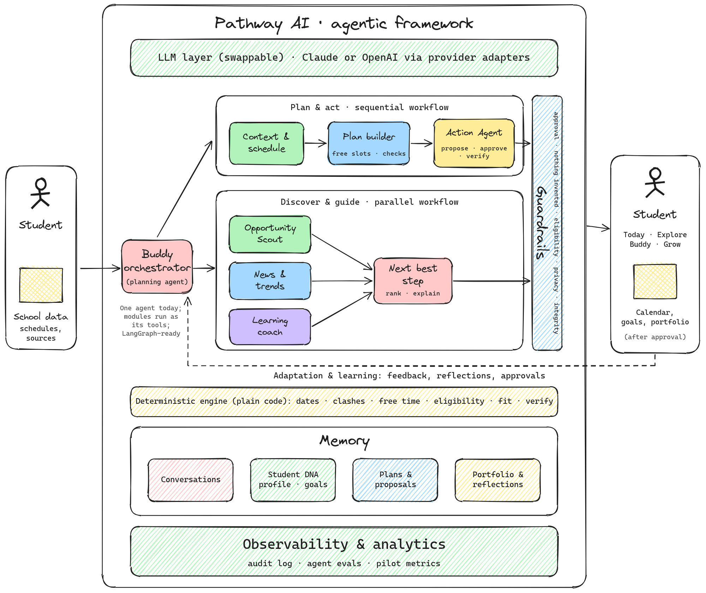

# Pathway AI

**Make the most of today. Build a better tomorrow.**

Pathway AI is an AI companion that helps high school students (grades 9–12) cut through the overwhelm, find what fits them, and build a path they're proud of, with counselor-style guidance that works alongside school counselors.

| ▶️ Demo video | 🌐 Live prototype | 📊 Pitch | 🛠️ Run it yourself |
|---|---|---|---|
| [Watch the 4-minute demo](./pathway-demo.mp4) | [Open the prototype](https://claude.ai/artifact/SEnFpbWcfZDJ4xSZgDJufs) | [Read the pitch page](https://claude.ai/artifact/Wrqd2qC8iDFH3MCjrqFixu) | [Trainer guide](../TRAINER-GUIDE.md) |

---

## The problem

Every student carries four questions, mostly alone:

| Question | What it's really about |
|---|---|
| **What should I do?** | Uncertainty: what matters, and where to start |
| **What fits me?** | Discovery: opportunities and trends that suit them |
| **How do I fit it all in?** | Overwhelm: everything scattered, no time to think |
| **Am I on the right path?** | The future: real readiness for college and beyond |

The information is everywhere. What's missing is **personal guidance**, and too often that depends on access to a private counselor.

## What Pathway does

One companion with three roles:

- **🧡 Buddy** eases the overwhelm: someone to talk to, encouragement, and help clearing your head.
- **💙 Organizer** brings it all together: the scattered week in one calm view, with plans that fit real free time.
- **💚 Guide** answers the unknowns: opportunities that fit, what to do next, and a clear path to college.

**The core promise:** Pathway suggests; the student decides. Nothing changes without a clear yes.

## See it in action

[**▶️ Watch the 4-minute demo**](./pathway-demo.mp4), following Maya, a 10th grader, through one day with Pathway:

- **Today:** a warm welcome, word of the day, news picked for her interests, and one next best step
- **Explore:** opportunities matched with reasons; a prep plan saved only after she approves it
- **Buddy:** "Clear my head", and study sessions planned around soccer practice
- **Grow:** her 10th-grade path, goals as small steps, and a portfolio she owns

## Architecture

**How it works:** the AI reasons and proposes; plain code decides facts; the student approves; the approval service makes the change and proves it happened.

1. **Ask:** the student asks Buddy, the orchestrating agent.
2. **Think and use tools:** Buddy calls the AI model and up to six tools, up to 6 rounds per message.
3. **Facts from code:** schedules, free time, eligibility and fit come from a tested rules engine, never from AI guesses.
4. **Propose:** changes become a proposal. Nothing is saved yet.
5. **Approve:** the student sees what will change and says yes or not now.
6. **Execute and verify:** one database transaction, every change checked, every step logged.

| Layer | Technology |
|---|---|
| Front end | React + TypeScript (Vite), mobile-first, Dusk/Dark/Light themes |
| Back end | Node.js + TypeScript (Fastify), validated APIs |
| AI | Provider-agnostic: **Claude, OpenAI, or local models via Ollama** |
| Agent | One orchestrator with typed tools; LangGraph-ready |
| Data | Prisma: SQLite for development, PostgreSQL for production |

## Built to be trusted

- ✋ **Students decide.** No change without approval.
- 🔎 **Nothing invented.** No made-up deadlines, links, news or achievements.
- 🔒 **Private by default.** Students can export or delete everything.
- 🧑‍🏫 **Learning, not shortcuts.** The study coach teaches; it never does graded work.

## Measuring impact

Our pilot will measure four outcomes: **less overwhelm**, **more of the right opportunities**, **better follow-through** on the plans students choose, and **a growth story they own**.

## Try it yourself

- **In your browser (no installs):** open this repository on GitHub › **Code** › **Codespaces** › **Create codespace on main**, then run `npm run dev`.
- **On a laptop:** see the [Trainer guide](../TRAINER-GUIDE.md).

AI features are optional: add your own Claude, OpenAI or Ollama settings to `.env` (never commit keys).

## Roadmap

| Now | Next | Later |
|---|---|---|
| Working prototype and build kit | Student pilot, real sign-in and consent, verified news and opportunity sources | Learning paths, week-ahead check-ins, growth insights, family and counselor views |

---

*Prototype status: opportunities are a labeled sample set; news stories link to their real sources. Maya is a fictional student.*
